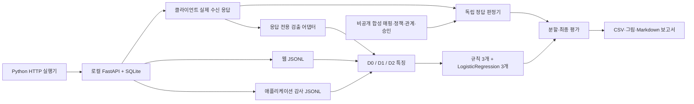

# 로컬 HTTP 개인정보 제공 탐지 연구 환경

> **경고:** 의도적인 인가·직렬화 결함을 포함한 합성 시험 서비스다. 신뢰하는 로컬 환경에서만 사용하고 외부에 공개하지 않는다. 로그인은 합성 actor를 선택하는 실험용 세션이며 운영 인증으로 사용하면 안 된다.

본 환경은 HTTP 응답 개인정보 검출 이벤트를 모사하는
연구용 시험환경이며, 상용 WAF나 상용 개인정보 접속기록
솔루션을 평가하지 않는다.

응답에서 개인정보가 검출된 경우 웹 요청·세션·접속기록 추가가 비인가 제공 탐지 성능에 주는 차이를 비교한다. RQ1=웹/세션 추가, RQ2=감사기록 추가, RQ3=동일 입력의 규칙/학습 비교, RQ4=누락·지연·연계 실패 영향이다. **성능이 개선되지 않거나 악화되어도 측정값 그대로 보고한다.**

실제 개인정보·비밀번호·기관 로그를 사용하지 않는다. 이메일은 example.test, 전화는 TEST-PHONE-*, 식별번호는 주민등록번호가 될 수 없는 SYN-* 문자열이다. 이메일·USB·PC 파일 반출, 외부 시스템 공격·인터넷 스캔, 법적 유출 확정, 상용 제품 성능, 운영망 처리량·고가용성 및 실시간 차단 효과는 범위 밖이다.

## 구성



| 디렉터리 | 역할 |
| --- | --- |
| app | FastAPI, SQLite 조회, 로컬 설정으로 제어하는 결함 |
| scenarios | 주소 제한, 준비 확인, 계획·실제 HTTP 실행 |
| detector | 교체 가능한 ResponseDetector 인터페이스, JSON 검출기 |
| ground_truth | 앱 인가 함수·검출기와 독립된 정답 판정 |
| pipeline | 파일·초기화, 관측 기반 특징, 분할, CLI |
| models | 화이트리스트, 규칙, 전처리·학습·임계값 저장 |
| evaluation | 테스트 지표, 사건 bootstrap, 그림·보고서 |
| configs | 규모·seed·규칙·사전 정의 오염 조건, JSON 정책 |
| tests / docs / scripts | 테스트 / 검증 기록 / 환경 확인 도구 |

## 설치

Python 3.11~3.13용 의존성 범위를 지정했으며 실제 검증 환경은 Windows / CPython 3.12이다. 다른 OS/Python 조합의 실행을 검증했다고 주장하지 않는다. pyproject.toml은 범위, requirements-lock.txt는 실제 설치한 정확한 버전이다. 설치와 이미지 빌드에는 인터넷 또는 미리 준비한 캐시가 필요하다. **설치 후 실험 실행에는 외부 연결·외부 API·텔레메트리가 필요 없다.**

Windows PowerShell:

```powershell
py -3.12 -m venv .venv
.\.venv\Scripts\python.exe -m pip install -r requirements-lock.txt
.\.venv\Scripts\python.exe -m pip install --no-deps -e .
$env:MPLCONFIGDIR = "$PWD\.runtime\matplotlib"
.\.venv\Scripts\python.exe -m pipeline.cli run --run-dir artifacts\smoke-01 --mode smoke
.\.venv\Scripts\python.exe -m pytest -q
```

현재 작업 환경은 py가 없어서 uv로 프로젝트 내부 Python을 준비했다. **이 작업 디렉터리에서는 이미 설치된 .venv 실행기를 바로 사용하면 된다.** 새 환경의 uv 설치 대안:

```powershell
$env:UV_PYTHON_INSTALL_DIR = "$PWD\.runtime"
uv --cache-dir .uv-cache venv --python 3.12 --managed-python .venv
uv --cache-dir .uv-cache pip install --python .venv\Scripts\python.exe -r requirements-lock.txt
uv --cache-dir .uv-cache pip install --python .venv\Scripts\python.exe --no-deps -e .
```

Linux/macOS:

```bash
python3.12 -m venv .venv
.venv/bin/python -m pip install -r requirements-lock.txt
.venv/bin/python -m pip install --no-deps -e .
export MPLCONFIGDIR="$PWD/.runtime/matplotlib"
.venv/bin/python -m pipeline.cli run --run-dir artifacts/smoke-01 --mode smoke
.venv/bin/python -m pytest -q
```

범위에 따라 새로 설치하려면 `python -m pip install -e ".[test]"`를 쓴다. 완전 오프라인 설치는 동일 OS/Python용 wheel들을 별도로 준비해 pip의 --no-index --find-links 옵션으로 설치한다. joblib 모델은 신뢰하는 이 프로젝트가 생성한 파일만 로드한다.

## 단계별 실행

저장소 루트에서 실행한다. Linux/macOS는 실행기를 .venv/bin/python으로, 경로 구분자를 /로 바꾼다.

```powershell
# 합성 데이터·SQLite·정책·설정·환경 기록
.\.venv\Scripts\python.exe -m pipeline.cli init --run-dir artifacts\manual-01 --seed 42
# 첫 터미널: localhost 서버, 종료 Ctrl+C
.\.venv\Scripts\python.exe -m pipeline.cli serve --run-dir artifacts\manual-01 --port 8000
```

두 번째 터미널:

```powershell
# 준비 확인 후 실제 HTTP smoke
.\.venv\Scripts\python.exe -m pipeline.cli scenarios --run-dir artifacts\manual-01 --mode smoke --url http://127.0.0.1:8000
# 독립 정답·전체/주 모집단·분할
.\.venv\Scripts\python.exe -m pipeline.cli truth --run-dir artifacts\manual-01
# 원본 보존, 조건별 특징
.\.venv\Scripts\python.exe -m pipeline.cli features --run-dir artifacts\manual-01 --conditions exact missing delayed restricted
# 순차 학습·검증 임계값 확정
.\.venv\Scripts\python.exe -m pipeline.cli train --run-dir artifacts\manual-01 --conditions exact missing delayed restricted
# 고정 모델·임계값으로 test 평가
.\.venv\Scripts\python.exe -m pipeline.cli evaluate --run-dir artifacts\manual-01 --conditions exact missing delayed restricted
.\.venv\Scripts\python.exe -m pipeline.cli report --run-dir artifacts\manual-01
```

전체 실행은 임시 loopback 포트에 서버를 시작하고 정상 종료한다. 실패 시 비정상 종료로 중단한다.

```powershell
.\.venv\Scripts\python.exe -m pipeline.cli run --run-dir artifacts\pilot-01 --mode pilot --seed 73 --bootstrap 500 --conditions exact missing delayed restricted
.\.venv\Scripts\python.exe -m pipeline.cli run --run-dir artifacts\experiment-01 --mode experiment --config configs\default.json --incidents 360 --seed 99
```

init/run에서 --seed, --incidents, --bootstrap, --config, --policy로 설정을 확정한다. 이후 단계는 저장된 config.json을 사용한다. 같은 경로나 이미 생성된 단계 산출물은 덮어쓰지 않는다. 실패 실행도 진단용으로 보존하고 **새 --run-dir**로 재실행한다. 같은 seed/설정/요청 순서의 데이터·계획·특징·분할은 재현되지만 실행시간·HTTP Date·실제 수신 시각까지 같다고 보장하지 않는다. 별도 요청을 끼워 넣으면 서버 counter 기반 시각/ID가 달라질 수 있다.

기본 smoke=36, pilot=120, experiment=360 사건이다. 사건당 1~3개 응답이며 대량 응답은 여러 객체를 담는다. 예정 사건·예정 응답·실제 응답 수를 구별한다. 이 규모가 통계적 충분성을 보장하지 않는다. 노트북에서는 smoke→pilot 순으로 확인하고 --bootstrap 20처럼 반복 수를 줄이거나 --conditions exact만 실행한다. GPU/LLM/유료 서비스/분산 로그 시스템을 쓰지 않으며 모델은 순차 학습한다.

## 로그·정답·입력 분리

observations/web.jsonl은 서버 middleware의 요청·세션·역할·경로·응답 메타데이터다. observations/audit.jsonl은 SQLite 조회를 수행한 **시험 웹서비스의 애플리케이션 감사 로그**다. DB 엔진의 실제 감사 로그가 아니며 읽은 객체·레코드 수·관측된 작업/담당 참조를 담고 위반 여부는 담지 않는다. 내부 조회가 일어나도 응답이 거부되어 개인정보가 나가지 않으면 제공 양성이 아니다.

observations/detector.jsonl은 실제 수신 HTTP body만 검사한다. JSON 키 분석과 이메일 정규표현식을 쓰며 DB·정책을 조회하지 않는다. 전체 식별번호는 SYN- 접두사와 마스킹 문자 부재로 판별한다. 값 자체는 이벤트에 저장하지 않는다. 합성 키에 의존하므로 다른 스키마·비정형 텍스트·HTML·인코딩·마스킹으로의 일반화에 한계가 있다. 별칭 contact_value 응답은 의도적으로 놓치는 사례다. ModSecurity 등은 ResponseDetector.inspect(body, metadata)와 같은 이벤트 스키마의 어댑터로 교체할 수 있다. ModSecurity는 설치 요건이 아니다.

private/responses는 응답 bytes의 hex·JSON·헤더·실제 수신 시각을 보존한다. private/evidence.jsonl은 run/incident/scenario ID, 관계 스냅샷·데이터 참조, 업무 참조, 수집 증거 위치·서버 설정을 보관한다. 취약 설정은 이 비공개 영역과 로컬 실행용 control.json에만 존재한다. HTTP 헤더/파라미터/관측 로그에 시나리오나 결함 설정을 전송하지 않는다.

정답 판정기는 수신 scalar 값을 합성 매핑에서 찾아 (객체, 필드, full/masked) 제공 집합을 만든다. 별칭도 알려진 값을 찾으며 중복 값은 응답 객체 문맥으로 구분한다. 정책·소유/담당 관계·권한 변경 증거·업무 승인으로 허용 집합을 **앱 인가 함수와 별개로** 계산한다. 임의 부분문자열·해시·새 표현은 범위 밖이다.

0=비인가 제공 없음(정상 제공·개인정보 없는 거부 포함), 1=실제 비인가 값 제공, U=정책/관계/응답 근거 부족이다. 공격 실행이라는 이유로 1을 부여하지 않는다. account_compromised는 별도 보조 메타데이터로 현재 null이다. 정책 버전·해시·참조, 실제/허용 집합·위반 사유·검증 상태는 private/labels.jsonl에 저장한다.

전체 모집단 private/population_all.jsonl은 모든 **시나리오 고객조회 응답**이다. 준비 확인·로그인은 보조 요청으로 제외한다. 검출 누락·PII 응답 커버리지는 전체 모집단에서 계산하며 수신 증거가 없는 사례를 검출기 오탐으로 단정하지 않는다. 주 모집단 private/population_main.jsonl은 검출 이벤트가 있는 고객조회 응답이다. 6개 비교군과 모든 오염 조건이 같은 행을 유지한다. U는 학습·검증·주 이진 평가에서 제외하고 건수·비율·원인을 보고한다.

## 특징·분할·평가

| 비교군 | 입력 | 방법 |
| --- | --- | --- |
| R0 / M0 | D0: 유형별 검출 수·크기·경로·상태·시각 파생 | 규칙 / LogisticRegression |
| R1 / M1 | D1: D0 + 간격·세션 과거 호출 수·객체 다양성·API 전이·관측 역할 | 규칙 확장 / 동일 모델 |
| R2 / M2 | D2: D1 + 감사 연계·기능·객체/레코드 수·반복 접근·작업/담당 참조 유무 | 규칙 확장 / 동일 모델 |

D2의 업무 맥락은 관측 참조의 유무까지다. 완전한 정답 정책·관계표를 결합하지 않는다. 원시 actor/object/session/request/run/incident/scenario ID, 레이블과 취약 설정은 versions/*/inputs/D*.csv에 없다. ID는 외부 row manifest와 분할·평가 관리에만 사용한다.

재현 가능한 **가상 event clock**을 요청 counter로 만들며 실제 실행시간·수신 시각과 분리한다. 실제 운영 수집 지연 분포를 재현했다는 뜻이 아니다. 판단 시점은 검출 시각+0.25초다. 미래 event 및 판단 시점 이후 ingested 로그를 사용하지 않는다. 세션 이력은 현재 웹 요청 이전의 관측치만 쓴다. 현재 응답·현재 감사는 판단 시점 내 도착하면 사용 가능하다.

사건별 시작/종료 시각을 산출하고 겹치는 사건은 하나의 시간 블록으로 묶는다. 시간순 블록의 60/20/20%를 train/validation/test에 배치하며 사건을 쪼개지 않는다. 작은 실행은 분할이 비거나 한 클래스뿐일 수 있다. splits.json에 분할을 고정한다. 이력에는 시간상 과거인 다른 분할 관측이 들어올 수 있지만 레이블은 쓰지 않는다.

결측 대치·스케일링·OneHotEncoder·LogisticRegression은 sklearn Pipeline이며 fit은 train만 사용한다. M0/M1/M2의 탐색 예산은 각각 C=1 후보 1개로 같다. 검증에서 목표 경보율 예산(기본 0.25)을 넘지 않는 최대 경보 수의 임계값을 선택한다. 동점 점수는 모두 포함하거나 모두 제외하며 예산 초과 동점 묶음은 제외한다. test에 고정 임계값을 적용하고 실제 경보율·재현율을 보고한다. test에서 경보 예산을 맞추려고 순위를 다시 자르지 않는다.

precision/recall/F1/FPR/average_precision·PR curve·confusion matrix·사건 탐지율·최초 탐지 응답 수·실행시간·연계율을 출력한다. **average_precision은 sklearn의 재현율 증가분 가중 precision 합으로 사다리꼴 PR-AUC가 아니다.** 경보가 없으면 precision=null, 한 클래스 test면 unavailable이다. train이 한 클래스면 M 계열은 학습 불가로 기록하며 점수를 만들지 않는다.

사건 탐지는 실제 양성 응답에 경보가 있어야 성공이다. 최초 탐지는 주 모집단 내 해당 사건 응답 순번이며 미탐 사건은 평균에서 제외하고 미탐 수를 함께 보고한다. F1 차이 M1−M0, M2−M1, R2−R1, M2−R2에 paired 사건 bootstrap의 동일 재표본을 사용한다. 한 클래스 재표본은 건너뛰고 유효 반복 수를 기록한다. 작은 표본의 넓거나 퇴화된 CI를 숨기지 않는다.

사전 조건은 exact(request_id), missing(감사 30% 누락), delayed(ingested_at +5초), restricted(감사 request_id 제거 후 사용자·기능·시간 창 매칭)다. 조건을 test 결과로 선택하지 않는다. 다중 후보는 ambiguous, 후보 없음은 unmatched로 남긴다. 진짜 매핑은 private/link_truth에 분리하고 후보 매칭에 전달하지 않으며 연계 precision/recall 계산에만 사용한다. 조건별 train/validation에서 다시 학습·임계값 선택하는 **동일 조건 내 재학습 실험**이며 깨끗한 모델의 배포 후 견고성 주장과 구별한다.

## 산출물

```text
artifacts/<experiment>/
  config.json, environment.json, scenario_summary.json, splits.json
  population_summary.json, report.md
  observations/{web,audit,detector}.jsonl
  private/
    data.json, data.sqlite, policy.json, plan.json, control.json
    responses/*.json, evidence.jsonl, labels.jsonl
    population_all.jsonl, population_main.jsonl, link_truth/*.json
  versions/<condition>/
    audit.jsonl, links.jsonl, row_manifest.jsonl, inputs/{D0,D1,D2}.csv
    models/M*.joblib, training.json, scores.jsonl
    feature_metadata.json, evaluation.json, bootstrap.json
    metrics.csv, incident_metrics.csv, *_pr.csv, *_confusion.csv, figures/*.png
```

생성 데이터는 Git에서 제외한다. 원본은 조건별 복사와 분리하며 출력 충돌은 오류다. environment.json은 Python/OS/패키지 버전·소스 SHA-256을 기록한다. smoke는 통합 확인이며 통계적 충분성·일반화·우수성을 입증하지 않는다.

## Docker (현재 환경에서 미검증)

```bash
docker compose build
docker compose run --rm lab-cli init --run-dir /lab/artifacts/compose
docker compose up -d lab-api
docker compose run --rm lab-cli scenarios --run-dir /lab/artifacts/compose --url http://lab-api:8000 --compose-target
docker compose run --rm lab-cli truth --run-dir /lab/artifacts/compose
docker compose run --rm lab-cli features --run-dir /lab/artifacts/compose
docker compose run --rm lab-cli train --run-dir /lab/artifacts/compose
docker compose run --rm lab-cli evaluate --run-dir /lab/artifacts/compose
docker compose run --rm lab-cli report --run-dir /lab/artifacts/compose
docker compose down
```

호스트 포트는 127.0.0.1 바인딩이고 서비스 네트워크는 internal: true다. Docker 내부 listen은 --container-listen이 필요하다. 실행기는 기본 loopback HTTP origin만 허용하고 --compose-target에서 정확한 서비스명 lab-api만 추가 허용한다. redirect를 따르지 않고 환경 프록시도 사용하지 않는다. 외부 URL은 요청 전에 차단한다.

검증 항목 대응은 docs/test-matrix.md, 실제 실행 기록은 docs/validation.md를 참조한다.
